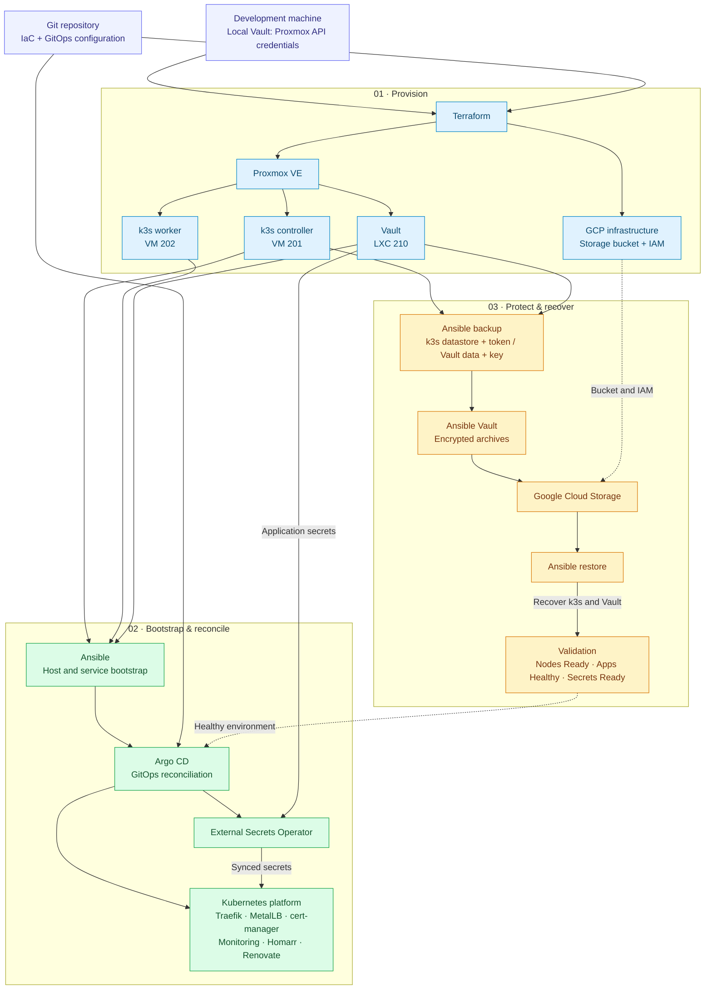

# Proxmox IaC K3s Lab

A hands-on Infrastructure as Code homelab for provisioning, configuring, operating, and recovering a small Kubernetes environment across **Proxmox VE** and **Google Cloud**.

The goal is reproducibility and practical infrastructure engineering—not a production-ready platform or a large application stack.

## Architecture

| Layer | Tools | Purpose |
| --- | --- | --- |
| Virtualization | Proxmox VE | Hosts the Kubernetes VMs and Vault LXC |
| Provisioning | Terraform | Manages Proxmox VMs, Vault LXC, and GCP resources |
| Configuration | Ansible | Bootstraps and updates hosts and services; handles backup/restore |
| Kubernetes | k3s | Controller and worker |
| GitOps | Argo CD | Reconciles platform configuration from Git |
| Networking & TLS | Traefik, MetalLB, cert-manager | Local ingress, load balancing, certificates |
| Secrets | Vault, External Secrets Operator | Supplies application secrets without putting values in Git |
| Monitoring & updates | Prometheus, Grafana, Renovate | Cluster visibility and dependency updates |
| Recovery | Ansible Vault, Google Cloud Storage | Encrypted Vault backups and local/GCS recovery workflows |

A **separate development-machine Vault** holds the Proxmox API credential used by Terraform. The Vault LXC holds Kubernetes application secrets. They are not interchangeable.

## What's included

- Automated VM/LXC provisioning with isolated Terraform states.
- k3s, Traefik, Argo CD, and Vault bootstrap through Ansible.
- GitOps-managed Argo CD, cert-manager, External Secrets, MetalLB, Prometheus/Grafana, Homarr, and Renovate.
- Maintenance playbooks and separate local/GCP backup and restore workflows for **k3s and Vault**.
- Service Account Impersonation for GCS, without Service Account JSON keys.

## Getting started

Follow **[INSTALLATION.md](INSTALLATION.md)** from the beginning: Proxmox API identity, local Vault credentials, Terraform, Ansible, Argo CD, Vault integration, and verification.

Use the layer-specific guides for ongoing operations:

| Guide | Contains |
| --- | --- |
| [Terraform](terraform/_docs/README.md) | Resources, access, plan/apply, and GCP configuration |
| [Ansible](ansible/_docs/README.md) | Bootstrap, updates, local/GCS backup and restore commands |
| [Kubernetes / GitOps](_kubernetes/_docs/README.md) | Argo CD, platform components, secrets, and validation |

## Verified results

**3 November 2026 — clean rebuild and GCP recovery test.** The Terraform-managed Proxmox VMs and Vault LXC were destroyed and recreated, and the nine GCP resources (bucket, prefixes, service account, IAM bindings, and APIs) were recreated without recreating the existing GCP project. Ansible installed k3s, Traefik, Argo CD, and Vault; GitOps reconciled the reduced platform.

Encrypted GCS backups and restores of **both k3s and cluster Vault** succeeded. Final post-restore checks showed both k3s nodes `Ready`, all **13** Argo CD Applications `Synced / Healthy`, Vault ClusterSecretStore `Valid / Ready=True`, and both ExternalSecrets `SecretSynced / Ready=True`.

The rebuild **was not fully unattended**: the Proxmox API token and local development Vault were reused; cluster Vault initialization, secrets, and GCP impersonation binding required manual steps. The first LXC provisioning attempt stalled and required a clean retry; Ansible was rerun after SSH became available. A malformed k3s GCP restore YAML file was fixed before the successful restore. Homarr required a correctly formatted encryption key and a restart/recovery of its embedded Redis cache. See [installation](INSTALLATION.md) and [Ansible recovery notes](ansible/_docs/README.md).

**2 November 2026 — local and GCS recovery.** k3s and Vault were also backed up and restored locally and through GCS on the existing lab.

**Recovery scope:** k3s SQLite datastore/server token and cluster Vault data/unseal key. **PVC data is not backed up by these workflows.** Rollback is attempted but is not guaranteed after every failure.

## Design boundaries

This is a learning/portfolio environment, not production-grade disaster recovery. Its Vault auto-unseal helper uses a local disk key for lab convenience. Secrets, tokens, backup encryption passwords, kubeconfigs, and Terraform state must stay outside Git. The GitOps platform intentionally excludes unused Longhorn, CloudNativePG, pgAdmin, and Reloader components.

## License

MIT — see [LICENSE](LICENSE).
